# 🐾 PawMatch

[](https://github.com/chodragon04/PawMatch/actions/workflows/test.yml)

**사진과 생활 환경으로 찾는 유기견 입양 매칭 웹서비스** (오픈소스소프트웨어 텀프로젝트)

**🔗 데모: https://pawmatch-kr.streamlit.app** · 휴대폰과 PC 모두 지원

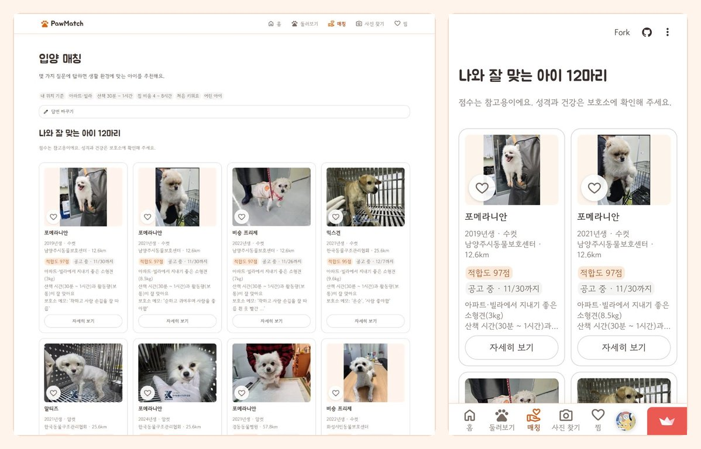

## 한눈에 보기

- **무엇을**: 전국 보호소에서 가족을 기다리는 유기견 약 3,300마리(국가동물보호정보시스템 공공데이터)를
  **생활 환경 · 사진 · 보호소 메모**로 찾아 주는 웹서비스입니다.
- **문제**: 2024년 전국 동물보호센터에 들어온 유실·유기동물은 10만 6,824마리였지만, 새 가족에게 입양된 것은 23.5%(2만 5,136마리)뿐이었습니다.
  입양 비율은 2021년 32.1% 이후 3년째 줄고 있습니다.[^adopt] 입양 뒤에도 반려동물 양육자의 18.2%가 양육 포기를 고려한 적이 있고,
  그 이유는 짖음 같은 행동 문제(45.7%)와 예상보다 큰 지출(40.2%)이 가장 많았습니다.[^giveup] **처음부터 내 생활에 맞는 아이를 고르는 것**이 중요합니다.
- **기존 서비스의 한계**: 국가동물보호정보시스템이나 포인핸드 같은 서비스는 지역·품종·기간으로 공고를 조회하는 방식이라,
  "우리 집 환경에 맞는 아이", "사진 속 아이와 닮은 아이", "메모에 순하다고 적힌 아이"로는 찾을 수 없습니다.
- **해결 방안 (PawMatch의 차별점)**
  1. **입양 매칭**: 주거 형태·산책 시간·가족 구성 설문으로 적합도 점수와 추천 이유("보호소 메모: '순한 편'")를 보여줍니다.
  2. **사진으로 찾기**: 강아지 사진을 올리면 CLIP 이미지 모델로 생김새가 비슷한 보호견을 찾습니다.
  3. **메모 검색**: 보호소 메모를 성격·건강 정보로 분석해, "순한"으로 찾으면 '온순함'·'얌전'으로 적힌 아이도 찾습니다.
- **기대 효과**: 처음 반려견을 들이는 사람도 집 형태·산책 시간·가족 구성만 답하면 잘 맞는 아이와 그 이유를 알 수 있습니다.
  "생각과 달라서" 양육을 포기하는 일을 줄이는 데 도움을 주고자 합니다.
- **핵심 기술**: 공공데이터 수집 파이프라인(GitHub Actions + 앱 자체 갱신) · CLIP(ONNX) 사진 임베딩 증분 계산 ·
  정규식 메모 분석(부정어 처리) · 위치 기반 가까운 보호소 정렬(카카오 로컬 API, 좌표 보정) · 휴대폰·PC 반응형과 접근성
- **완성도**: 실제 배포, 사용자 테스트 의견 반영, PR 40여 개, 테스트 215개(PR마다 자동 실행)
- **라이선스**: MIT · 데이터: 공공데이터포털(이용허락범위 제한 없음) · [AI 사용 범위](#ai-사용-범위)

[^adopt]: 농림축산검역본부, 2024년 반려동물 보호·복지 실태조사 ([정책브리핑 보도자료](https://www.korea.kr/briefing/pressReleaseView.do?newsId=156690996), [데일리벳 기사](https://www.dailyvet.co.kr/news/policy/248072))
[^giveup]: 농림축산식품부, 2023년 동물복지에 대한 국민의식조사 (2024년 1월 발표, [한경매거진 기사](https://magazine.hankyung.com/business/article/202401168185b))

## 목차

- [주요 기능](#주요-기능)
- [데모 / 스크린샷](#데모--스크린샷)
- [기술 스택](#기술-스택)
- [시스템 구조](#시스템-구조)
- [프로젝트 구조](#프로젝트-구조)
- [실행 방법](#실행-방법)
- [배포](#배포-streamlit-community-cloud)
- [데이터 자동 갱신](#데이터-자동-갱신-github-actions)
- [사진으로 찾기](#사진으로-찾기)
- [찜하기](#찜하기)
- [입양 매칭 점수](#입양-매칭-점수)
- [지역 선택](#지역-선택-시도--시군구)
- [사용자 테스트와 개선](#사용자-테스트와-개선)
- [휴대폰·PC 화면과 접근성](#휴대폰pc-화면과-접근성)
- [AI 사용 범위](#ai-사용-범위)
- [데이터 출처](#데이터-출처)
- [참고자료](#참고자료)
- [오픈소스 라이선스](#오픈소스-라이선스)
- [라이선스](#라이선스)

## 주요 기능

- 🏠 **홈**: 내 위치나 고른 지역에서 가까운 보호소의 아이들부터 보기
- 🐾 **보호견 둘러보기**: 원하는 아이가 있다면 지역·크기·나이·품종·검색어로 직접 찾기 (가까운 순 정렬, "순한"처럼 비슷한 말도 찾기)
- 🤝 **입양 매칭**: 어떤 아이가 맞을지 모르겠다면 생활 환경 설문으로 잘 맞는 아이와 그 이유 알아보기
- 📷 **사진으로 찾기**: 강아지 사진을 올리면 생김새가 비슷한 보호견 찾기
- 🧡 **찜**: 마음에 드는 아이를 하트로 모아 두고 다시 보기
- 📱💻 **휴대폰과 PC 모두**: 휴대폰은 하단 탭·2열 카드, PC는 위쪽 메뉴·4열 카드

| 기능 | 설명 | 상태 |
| --- | --- | --- |
| 가까운 보호소 우선 보기 | 내 위치(또는 고른 시/도·시/군/구)에서 가까운 보호소 순으로, 보호소별로 묶어 표시 | 완료 |
| 보호견 둘러보기 | 지역·크기·나이·성별·상태·품종·검색어로 직접 찾기. 최근 등록순·공고 마감 임박순·오래 기다린 순·**가까운 순** 정렬(카드에 보호소까지 거리). 입양 매칭 설문을 했다면 '나와 잘 맞는 순'과 적합도 표시. 고른 조건을 입양 매칭으로 가져가기 | 완료 |
| 메모 검색 | 검색어를 보호소 메모의 성격 분석과 연결해 **비슷한 말도 찾기**('순한' → 온순·얌전·착함), 띄어쓰기가 달라도 찾기('사람좋아' ↔ '사람 좋아함') | 완료 |
| 결과 먼저 보기 | 휴대폰에서는 둘러보기 검색 조건을 접어 두고 고른 조건을 요약 칩으로 표시. 입양 매칭은 제출하면 설문을 접고 결과로 바로 이동 | 완료 |
| 입양 매칭 | 생활 환경 설문(주거 형태, 산책 시간, 반려 경험, 가족 구성, 집 비우는 시간)으로 적합도 점수를 계산해 추천 이유·주의할 점과 함께 추천. 원하는 크기·나이·성별·품종은 선택 항목 | 완료 |
| 자세히 보기 | 모든 화면의 같은 카드에서 사진 넘겨 보기(휴대폰은 밀어서, PC는 ←/→ 키), 상세 정보, 보호소 메모, 보호소 주소·연락처·운영 시간 | 완료 |
| 사진으로 찾기 | 강아지 사진을 올리거나(PC는 끌어다 놓기도 됨) 찍으면 사전학습 이미지 모델(CLIP)로 생김새가 비슷한 보호견 검색, 시/도·시/군/구로 좁히기 | 완료 |
| 찜하기 | 카드 사진 왼쪽 아래 하트로 마음에 드는 아이를 모아 두고 '찜' 탭에서 보기. 찜 목록은 브라우저에만 저장(로그인 필요 없음) | 완료 |
| 화면 이동 | 휴대폰은 화면 맨 아래 고정 아이콘 탭, PC(폭 1024px 이상)는 위쪽 메뉴. 다른 화면에 갔다 와도 입력한 조건 유지. 한 번 받은 내 위치·켠 카메라는 30분 동안 다시 묻지 않음 | 완료 |
| 휴대폰·PC 대응, 접근성 | 휴대폰 2열·PC 4열 카드, 넓은 화면은 내용 폭 1280px, 버튼 44px, 글자 대비, 키보드 사용, 화면 읽기 프로그램용 이름 ([자세히](#휴대폰pc-화면과-접근성)) | 완료 |
| 데이터 자동 갱신 | GitHub Actions가 받아 둔 데이터로 첫 화면이 빠르게 열리고, 데이터가 40분보다 오래되면 앱이 뒤에서 새로 받음 | 완료 |

## 데모 / 스크린샷

배포 주소: **https://pawmatch-kr.streamlit.app** (Streamlit Community Cloud, main 브랜치가 자동 반영됨)

> Streamlit은 약 12시간 동안 아무도 쓰지 않은 앱을 재워 둡니다. GitHub Actions가 2시간마다 앱을 열어 깨워 두지만
> (`.github/workflows/keep-awake.yml`), 그래도 "Yes, get this app back up!" 버튼이 보이면 눌러서 깨워 주세요(1분 정도 걸림).
> 사진으로 찾기는 처음 사진을 올릴 때 분석 모델을 준비하느라 조금 더 걸립니다.

> 스크린샷과 앱에 나오는 동물 사진·정보는 각 동물보호센터가 국가동물보호정보시스템에 올린 공공데이터입니다.
> ([데이터 출처](#데이터-출처) 참고)

스크린샷은 2026년 11월 26일 배포된 앱을 실제 PC 브라우저와 휴대폰(iPhone 14 Pro, Safari)으로 찍었습니다(내 위치 기준).
휴대폰 화면은 위쪽 상태 표시줄과 아래쪽 브라우저 주소창을 잘라 냈습니다.

### 휴대폰

<table>
  <tr>
    <td align="center" width="33%">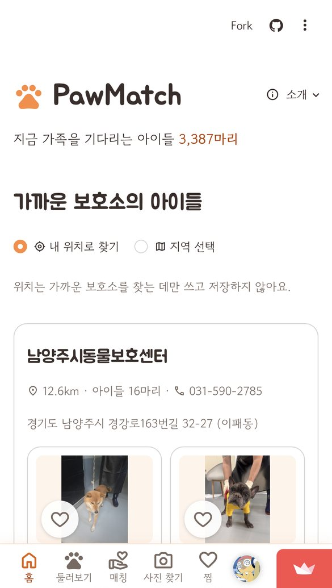<br><b>홈</b><br>가까운 보호소부터, 보호소별로 묶어서</td>
    <td align="center" width="33%">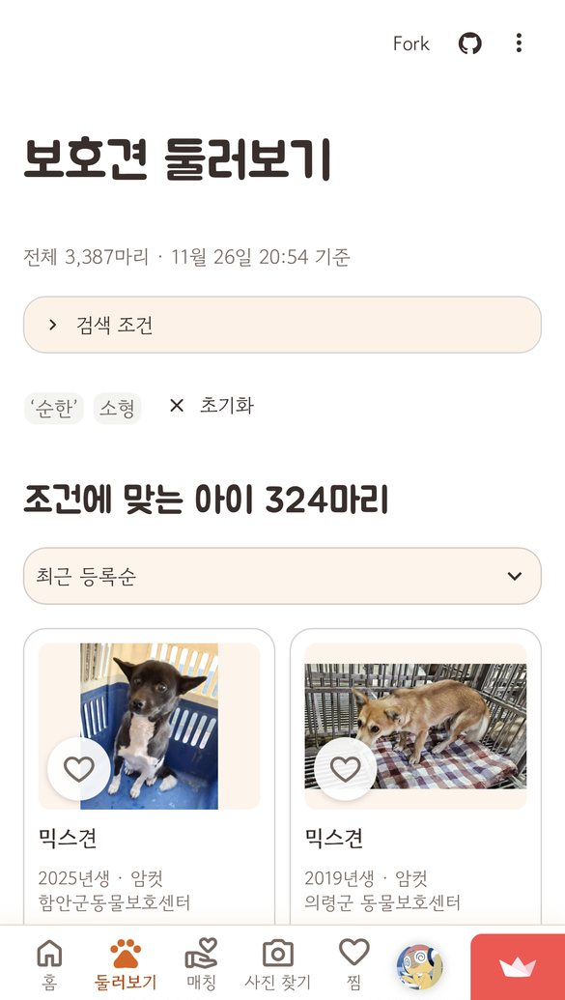<br><b>보호견 둘러보기</b><br>조건은 접고 요약 칩으로, 결과가 먼저</td>
    <td align="center" width="33%">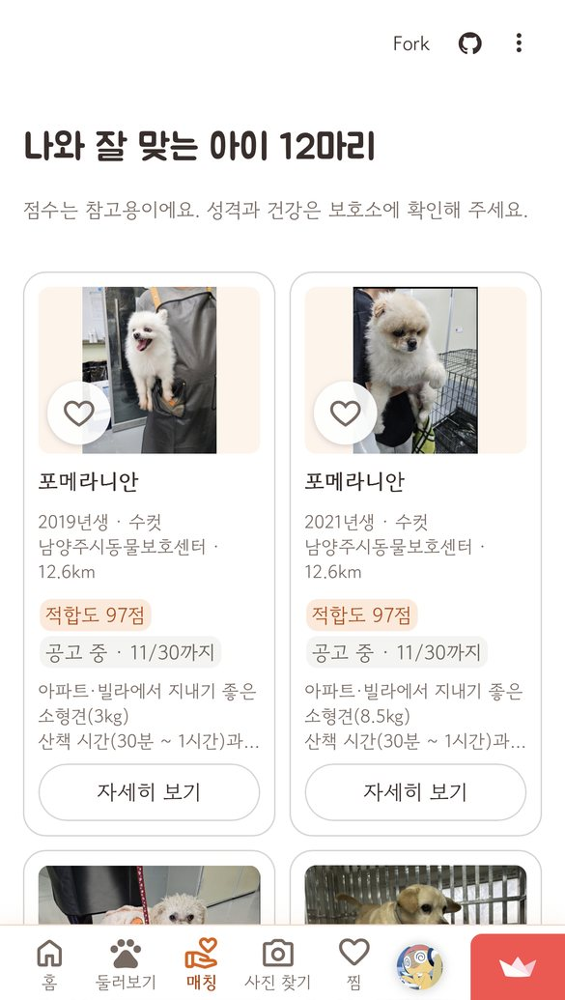<br><b>입양 매칭</b><br>제출하면 답변을 접고 결과로 이동</td>
  </tr>
  <tr>
    <td align="center">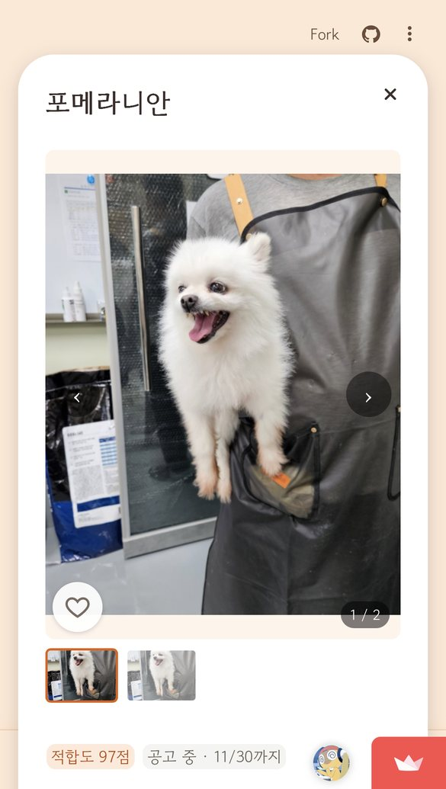<br><b>자세히 보기</b><br>사진 넘겨 보기, 적합도, 하트</td>
    <td align="center">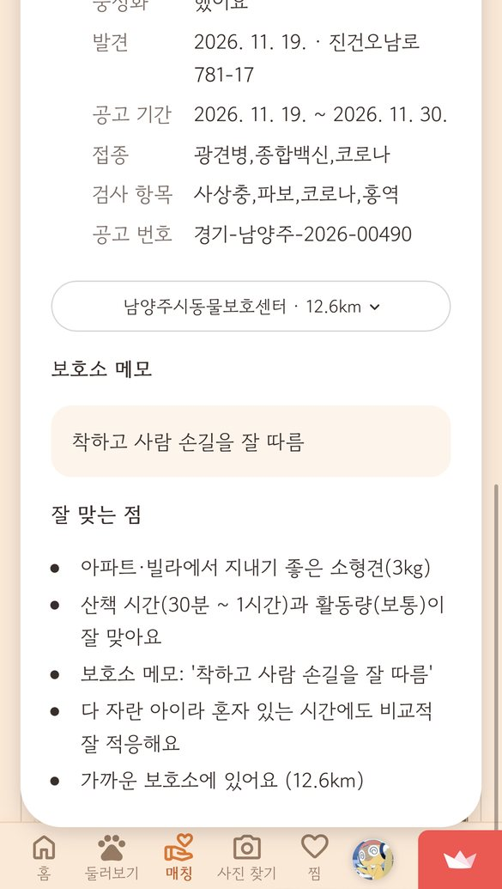<br><b>자세히 보기 (아래)</b><br>보호소 메모, 잘 맞는 점</td>
    <td align="center">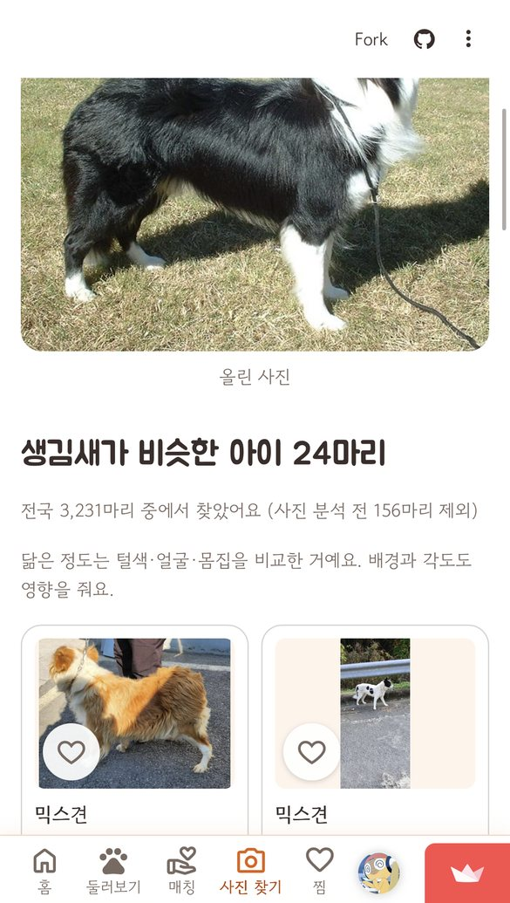<br><b>사진으로 찾기</b><br>올린 사진과 털색·생김새가 비슷한 아이들</td>
  </tr>
  <tr>
    <td align="center">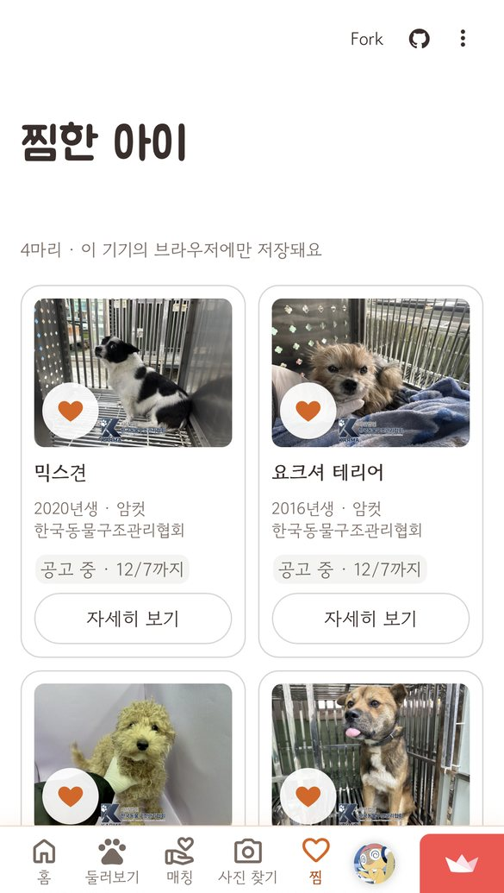<br><b>찜</b><br>하트를 누른 아이 모아 보기</td>
    <td></td>
    <td></td>
  </tr>
</table>

### PC

PC(폭 1024px 이상)에서는 메뉴가 화면 위쪽으로 가고, 카드가 한 줄에 4장 놓입니다. 둘러보기 검색 조건은 펼쳐 둡니다.

**홈**: 위쪽 메뉴와 보호소 묶음

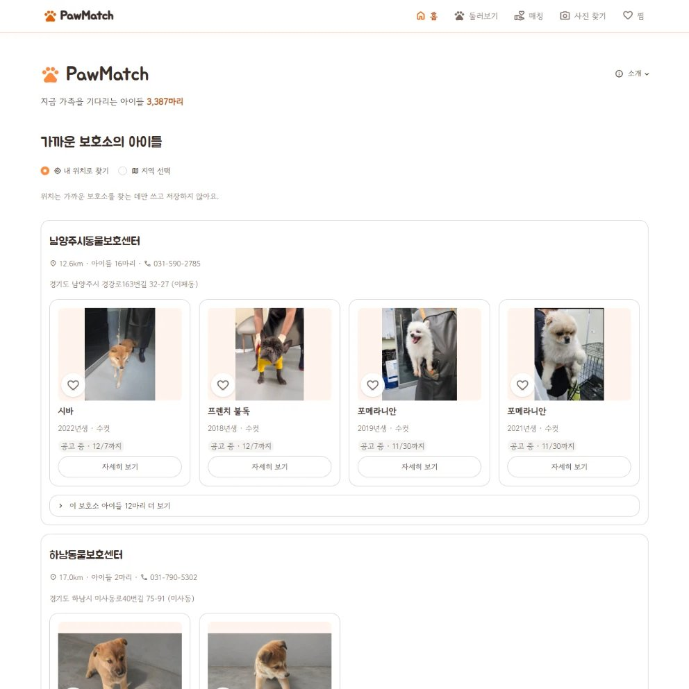

**보호견 둘러보기**: 검색어 "순한" + 소형. 메모에 '온순함', '얌전'으로 적힌 아이도 함께 찾습니다.

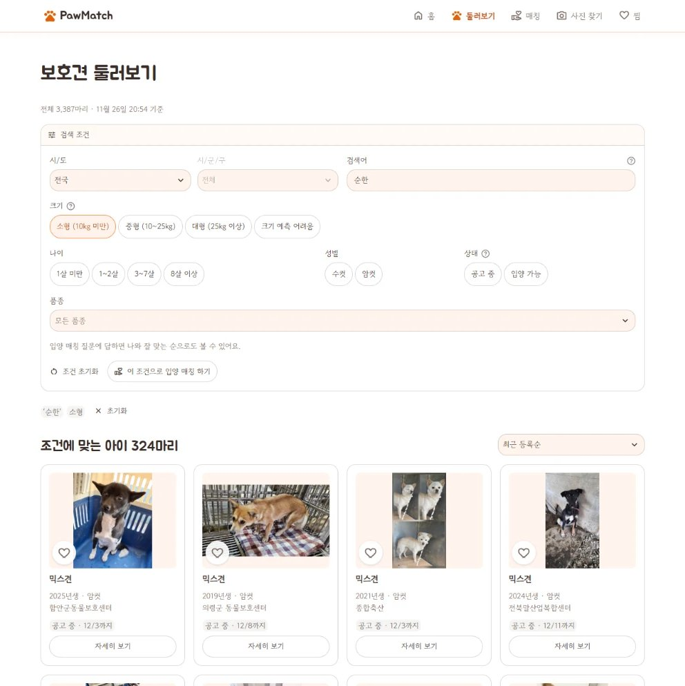

**입양 매칭**: 적합도와 추천 이유(보호소 메모 인용)

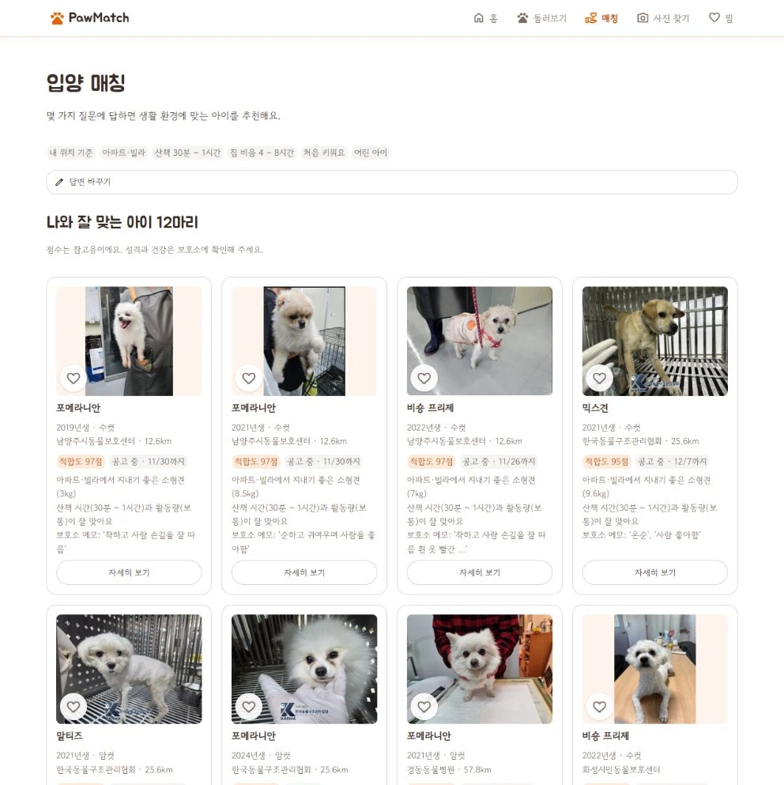

## 기술 스택

- **언어**: Python 3.12 (3.10 이상에서 동작)
- **웹 프레임워크**: [Streamlit](https://streamlit.io/)
- **데이터**: 공공데이터포털 국가동물보호정보시스템 구조동물 조회 서비스
- **이미지 검색**: 사전학습 이미지 모델 CLIP ViT-B/32 (ONNX), [fastembed](https://github.com/qdrant/fastembed) + onnxruntime (PyTorch 없이 CPU로 실행)
- **데이터 갱신**: GitHub Actions (30분마다 실행, `data` 브랜치에 스냅샷 저장)
- **디자인**: 흰 배경 + 주황 포인트(`#FF8A3D`) 테마(`.streamlit/config.toml`), 휴대폰이 다크 모드여도 밝은 화면 유지. 글꼴 Jua(제목)·Gowun Dodum(본문), Material 아이콘. 휴대폰은 하단 고정 탭, PC는 위쪽 메뉴(CSS 화면 폭 조건). 색은 `pawmatch/colors.py` 한 곳에서 관리
- **찜 저장**: 브라우저 localStorage ([streamlit-js-eval](https://github.com/aghasemi/streamlit_js_eval)로 읽기)
- **배포**: [Streamlit Community Cloud](https://streamlit.io/cloud) (GitHub 푸시 시 자동 반영)

## 시스템 구조

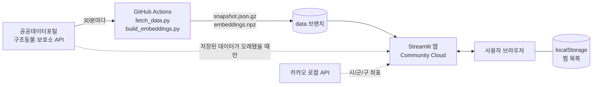

- 공공데이터 API는 느리고 가끔 끊겨서, GitHub Actions가 미리 받아 둔 스냅샷을 앱이 바로 읽습니다. ([데이터 자동 갱신](#데이터-자동-갱신-github-actions))
- 사진으로 찾기에 쓰는 보호견 사진 임베딩도 같은 워크플로에서 새로 들어온 사진만 계산해 둡니다. ([사진으로 찾기](#사진으로-찾기))
- 사용자가 올린 사진, 내 위치, 찜 목록은 서버에 저장하지 않습니다.

## 프로젝트 구조

```
PawMatch/
├── app.py               # Streamlit 진입점 (페이지 목록, 하단 탭, 배포 갱신 때 모듈 다시 불러오기)
├── CLAUDE.md            # AI 코딩 도구(Claude Code) 작업 규칙
├── .streamlit/config.toml # 화면 테마 (색·글꼴·모서리)
├── pytest.ini           # 테스트 설정 (프로젝트 루트를 모듈 경로에 추가)
├── views/               # 화면별 페이지 (app.py의 st.navigation으로 연결)
│   ├── home.py          # 홈
│   ├── browse.py        # 보호견 둘러보기
│   ├── match.py         # 입양 매칭
│   ├── photo_search.py  # 사진으로 찾기
│   └── favorites.py     # 찜한 아이
├── pawmatch/            # 핵심 로직
│   ├── config.py        # 환경 변수(API 키) 로딩
│   ├── api.py           # 공공데이터 API 클라이언트 (유기견, 보호소, 동시 요청·재시도)
│   ├── data.py          # 데이터 불러오기 (스냅샷 → API 순서)
│   ├── geo.py           # 거리 계산, 가까운 보호소 순 정렬, 시/도청 좌표
│   ├── regions.py       # 지역 선택 목록 (regions.json: 시/도 16곳, 시/군/구 229곳)
│   ├── kakao.py         # 카카오 로컬 API로 시/군/구·주소 위치 찾기
│   ├── shelter_coords.py # 주소와 안 맞는 보호소 좌표 바로잡기 (shelter_coords.json 적용)
│   ├── location.py      # 기준 위치 고르기 (내 위치 / 지역 선택), 모든 화면이 같이 쓰는 시/도·시/군/구 선택 부품
│   ├── state.py         # 여러 화면이 같이 쓰는 화면 상태 key (입력값 유지)
│   ├── traits.py        # 체중·나이·품종·특징 메모에서 크기·활동량·성격 추출 (메모 검색에도 사용)
│   ├── matching.py      # 설문 기반 매칭 점수 계산
│   ├── browse.py        # 보호견 둘러보기 조건 검색(비슷한 말 포함)·정렬(가까운 순 포함)
│   ├── display.py       # 나이·성별·공고 상태 표시 문구, 요약 칩
│   ├── colors.py        # 화면 색 (주황 포인트, 글자·캡션 색, 대비 계산)
│   ├── ui.py            # 사진·사진 캐러셀 (사진 대체 처리 포함), 하단 탭/PC 위쪽 메뉴, 접근성 보정, 데이터 로딩 화면
│   ├── favorites.py     # 찜하기: 하트 버튼, 브라우저 저장(localStorage), 찜 목록 읽기
│   ├── detail.py        # 유기견 카드(모든 화면 공통, 휴대폰 2열·PC 4열)와 상세 정보 창
│   └── image_search.py  # 사진으로 찾기: CLIP 임베딩 만들기·저장·유사도 검색
├── scripts/
│   ├── fetch_data.py    # 데이터 받아서 스냅샷 파일로 저장 (GitHub Actions에서 실행)
│   ├── check_shelter_coords.py # 보호소 주소를 카카오로 찾아 좌표 확인 (2026년 11월에 한 번 실행)
│   ├── build_embeddings.py # 보호견 사진 임베딩 만들기 (GitHub Actions에서 실행)
│   ├── build_regions.py # 구조동물 API의 시/도·시/군/구 목록으로 regions.json 생성
│   └── wake_app.py      # 배포된 앱을 브라우저로 열어 깨우기 (GitHub Actions에서 실행)
├── .github/workflows/
│   ├── update-data.yml  # 30분마다 데이터·사진 임베딩 갱신
│   ├── test.yml         # PR·main 반영 때마다 테스트 자동 실행
│   └── keep-awake.yml   # 2시간마다 배포된 앱을 열어 잠들지 않게 함
├── tests/               # 단위 테스트 + 화면 테스트 (pytest, test_app_pages.py는 앱 전체를 가짜 데이터로 실행)
├── data/                # 데이터 캐시 (Git에 올리지 않음)
├── docs/
│   ├── data-analysis.md # 공공데이터 필드 분석 (채워진 비율, 매칭에 쓸 정보)
│   └── images/          # README 스크린샷
├── requirements.txt
├── .env.example
└── LICENSE
```

## 실행 방법

1. 저장소 클론

   ```bash
   git clone https://github.com/chodragon04/PawMatch.git
   cd PawMatch
   ```

2. 가상환경 생성 및 패키지 설치

   ```bash
   python -m venv .venv
   source .venv/bin/activate   # Windows: .venv\Scripts\activate
   pip install -r requirements.txt
   ```

3. API 키 설정 (선택)

   API 키가 없어도 GitHub `data` 브랜치에 저장된 데이터(30분마다 갱신)로 실행됩니다.
   저장된 데이터가 오래됐을 때 앱이 뒤에서 API로 새로 받으려면 키가 필요합니다.

   [공공데이터포털](https://www.data.go.kr/)에서 "구조동물 조회 서비스"를 활용신청한 뒤,
   `.env.example`을 복사해 `.env`를 만들고 일반 인증키(Decoding)를 넣습니다.

   ```bash
   cp .env.example .env
   ```

   (`.streamlit/secrets.toml`을 써도 됩니다. `.streamlit/secrets.toml.example` 참고)

4. 실행

   ```bash
   streamlit run app.py
   ```

5. 데이터 직접 받기 (선택)

   API 키가 있으면 데이터를 받아 `data/snapshot/`에 저장해 둘 수 있습니다. 앱은 이 파일과 `data` 브랜치 스냅샷 중 새 것을 씁니다.

   ```bash
   python scripts/fetch_data.py
   ```

6. 테스트 (선택)

   ```bash
   pip install -r requirements-dev.txt
   pytest
   ```

   테스트는 실제 API·모델 없이 가짜 응답으로 돌아가서 API 키가 필요 없습니다.
   `tests/test_app_pages.py`는 Streamlit의 [AppTest](https://docs.streamlit.io/develop/api-reference/app-testing)로
   실제 `app.py`를 가짜 데이터로 실행해, 홈·둘러보기·입양 매칭·사진으로 찾기·찜 화면이 오류 없이 뜨고
   지역 고르기, 설문 제출 같은 주요 동작이 되는지 확인합니다(브라우저 없이 몇 초).
   GitHub에서는 PR을 올리거나 main에 반영될 때마다 자동으로 돌아갑니다(`.github/workflows/test.yml`).

## 배포 (Streamlit Community Cloud)

1. [share.streamlit.io](https://share.streamlit.io/)에 GitHub 계정으로 로그인
2. **Create app** → 이 저장소, 브랜치, Main file `app.py` 선택
3. **Advanced settings**에서 Python **3.12** 선택(기본값 3.14로 만들었을 때 화면 없이 로딩만 도는 문제가 있었음), **Secrets** 칸에 아래 내용 입력

   ```toml
   DATA_GO_KR_API_KEY = "발급받은_일반_인증키(Decoding)"
   KAKAO_REST_API_KEY = "카카오_REST_API_키"   # 선택: 시/군/구 위치 찾기
   ```

4. **Deploy** 클릭. 이후 해당 브랜치에 푸시하면 자동으로 다시 배포됩니다.

> 앱이 켜진 채로 새 코드가 들어오면 Streamlit은 `app.py`만 새로 읽고 `pawmatch/` 모듈은 예전 코드를 그대로 써서
> 오류가 날 수 있습니다. 그래서 `app.py`가 `pawmatch/` 파일이 바뀐 것을 보면 모듈을 다시 불러오게 했습니다.
> 그래도 화면이 예전 그대로면 오른쪽 아래 **Manage app → Reboot app**을 눌러 주세요.

## 데이터 자동 갱신 (GitHub Actions)

공공데이터 API는 한 번 요청에 2~9초가 걸리고 가끔 연결이 끊겨서, 데이터를 미리 받아 둡니다.

```
GitHub Actions (매시 7분·37분)        Streamlit 앱
  scripts/fetch_data.py                 pawmatch/data.py
  공공데이터 API → snapshot.json.gz  →  ① 로컬·data 브랜치 스냅샷 중 새 것을 바로 표시
  data 브랜치에 저장 (force push)       ② 40분보다 오래됐으면 뒤에서 새로 받아 바꿔 끼움
```

- `data` 브랜치는 매번 커밋 1개로 덮어써서 main의 커밋 기록에 영향을 주지 않습니다.
- GitHub의 예약 실행은 몇 시간씩 밀리거나 건너뛰는 경우가 많습니다. 2026년 11월 16~26일의 30번을 보면
  30분마다로 설정했는데도 실제 간격은 4.5~12시간(평균 약 8시간)이었습니다.
  그래서 앱은 **가진 데이터를 먼저 바로 보여주고**, 데이터가 40분보다 오래됐으면 **뒤에서** 새 스냅샷을 확인하고
  그래도 오래됐으면 API에서 직접 받아 바꿔 끼웁니다(5분에 한 번까지만 시도). 받은 데이터는 서버 안에서 모든 사용자가 같이 씁니다.
  첫 화면이 API 응답(5~15초)을 기다리는 경우는 저장된 스냅샷이 하나도 없을 때뿐입니다.
- 설정: 저장소 **Settings → Secrets and variables → Actions → New repository secret**에
  `DATA_GO_KR_API_KEY`(일반 인증키, Decoding)를 등록합니다.
- 수동 실행: **Actions → 보호견 데이터 갱신 → Run workflow** (2~6분 뒤 `data` 브랜치에 반영)
- 앱이 API에서 직접 받은 데이터는 서버 안에만 두고 `data` 브랜치에 저장하지 않습니다. 그래서 사진 임베딩은 Actions가 돌 때만
  새로 만들어지고, 그 사이 새로 들어온 아이는 사진으로 찾기에서 "사진 분석 전 N마리 제외"로 빠집니다.
- 화면에 쓰지 않는 개인 정보(보호소 대표자 이름, 동물등록번호)는 스냅샷에 저장하지 않습니다.
- 같은 워크플로에서 '사진으로 찾기'용 보호견 사진 임베딩(`embeddings.npz`)도 만듭니다(`scripts/build_embeddings.py`).
  이전에 계산한 사진은 다시 계산하지 않고 새로 들어온 아이의 사진만 계산하며, 한 번에 최대 30분까지만 계산하고 남은 사진은 다음 실행에서 이어 갑니다.

## 사진으로 찾기

- 보호견마다 사진을 최대 3장 골라, CLIP 이미지 인코더로 512차원 벡터(임베딩)를 미리 계산해 둡니다.
- 사용자가 올린 사진도 같은 모델로 벡터를 만들고, 코사인 유사도가 높은 순으로 보여줍니다.
  한 아이의 사진이 여러 장이면 가장 닮은 사진의 점수를 쓰고, 카드에도 그 사진을 먼저 보여줍니다.
- 직접 잰 결과 (보호견 389마리, 같은 아이의 다른 사진으로 검색): 같은 아이가 1위 82%, 5위 안 90%, 10위 안 93%.
  같은 아이 사진끼리 유사도 중앙값 0.95, 다른 아이끼리 0.75, 강아지가 아닌 그림은 0.55~0.60이라
  가장 닮은 아이가 0.7보다 낮으면 "많이 닮은 아이를 찾지 못했어요"라고 안내합니다.
  (같은 아이의 사진은 같은 장소에서 찍은 경우가 많아 배경이 점수를 높였을 수 있습니다)
- 사진 한 장 분석 약 70ms, 모델(약 340MB)은 서버가 처음 쓸 때 한 번 내려받아 모든 사용자가 같이 씁니다.
- 올린 사진은 비슷한 아이를 찾는 데에만 쓰고 저장하지 않습니다.

## 찜하기

- 카드 사진 왼쪽 아래 하트를 누르면 그 아이의 공고 번호를 브라우저 localStorage(`pawmatch_favorites`)에 저장합니다.
  서버를 거치지 않아 바로 바뀌고, 같은 아이의 하트는 화면 어디에 있든 같이 바뀝니다.
- 서버에는 저장하지 않아 로그인이 필요 없습니다. 대신 기기·브라우저마다 따로 저장되고, 브라우저 기록을 지우면 사라집니다.
- '찜' 화면은 [streamlit-js-eval](https://github.com/aghasemi/streamlit_js_eval)로 목록을 읽어 지금 데이터와 맞춰 보여줍니다.
  입양됐거나 공고가 끝나 데이터에서 빠진 아이는 몇 마리인지만 알려줍니다. (최근 찜한 순으로 최대 200마리)

## 입양 매칭 점수

설문 응답과 보호소가 입력한 정보(체중, 나이, 품종, 특징 메모)로 항목별 점수(0~1)를 계산하고,
비중을 곱해 100점 만점으로 합칩니다. 어떤 정보가 얼마나 채워져 있는지는
[공공데이터 필드 분석](docs/data-analysis.md)에 정리했습니다.

| 항목 | 비중 | 근거 |
| --- | --- | --- |
| 크기 | 25 | 주거 형태 × 체중(10kg 미만 소형, 25kg 이상 대형). 1살 미만은 품종으로 다 자란 크기 추정 |
| 활동량 | 20 | 산책 시간 × 나이·활동적인 품종·특징 메모('활발', '얌전')로 추정한 활동량 |
| 성격 | 20 | 특징 메모의 '온순', '사람 좋아함'(가점), '겁', '사나움', '입질'(감점) × 반려 경험·가족 구성 |
| 돌봄 시간 | 15 | 집을 비우는 시간 × 나이 (60일 미만 강아지는 오래 혼자 두기 어려움) |
| 거리 | 15 | 기준 위치에서 보호소까지 거리 |
| 선호 | 5 | 원하는 크기·나이·성별, 치료가 필요한 아이도 괜찮은지 |

- 정보가 없으면(성격 메모 없음, 체중 오입력, 보호소 좌표 없음) 감점하지 않고 중간 점수(0.5)를 줍니다.
- 품종(여러 개 선택 가능)과 보호소까지 최대 거리는 점수가 아니라 조건입니다. 고르면 그에 맞는 아이만 추천합니다.
- '입질 없음', '사상충 음성'처럼 부정하는 표현은 반대로 해석합니다.
- 점수와 함께 "아파트·빌라에서 지내기 좋은 소형견(4.4kg)", "보호소 메모: '온순', '친화적'" 같은 추천 이유와
  주의할 점을 보여줍니다.

### 보호소 메모 분석 (매칭과 검색에 같이 사용)

보호소가 자유롭게 적은 특징 메모(`specialMark`, 중앙값 16자)에서 정해 둔 단어 목록(정규식)으로 성격·건강 정보를 찾습니다
(`pawmatch/traits.py`). 2026년 11월 26일 데이터 3,338마리 기준입니다.

| 묶음 | 찾는 말 (예) | 해당 | 쓰이는 곳 |
| --- | --- | --- | --- |
| 온순 | 온순, 순하·순한, 얌전, 착하 | 1,026 (31%) | 성격 가점, 추천 이유 인용 |
| 사람 좋아함 | 사람 잘 따름, 애교, 친화, 친근 | 309 (9%) | 성격 가점, 추천 이유 인용 |
| 겁·경계 | 겁, 소심, 경계, 예민 | 626 (19%) | 처음 키우거나 아이가 있으면 감점·주의 |
| 사나움·입질 | 사나, 공격, 입질, 무는 | 123 (4%) | 감점, "성격을 꼭 문의해 보세요" |
| 활발 / 차분 | 활발, 장난 / 조용, 차분 | 98 / 119 | 활동량 추정 |
| 건강 | 피부, 골절, 사상충, 치료 등 | 348 (10%) | 치료가 필요한 아이를 원하지 않으면 감점·주의 |

- '입질 없음'처럼 바로 뒤에 부정하는 말이 오면 순한 것으로, '사상충 음성'·'심장사상충약'은 건강 문제가 아닌 것으로 봅니다.
- **둘러보기 검색어도 같은 분석을 씁니다.** 검색어 낱말이 위 묶음에 해당하면(예: '순한' → 온순) 메모에 다른 말로 적힌 아이도 찾고,
  띄어쓰기를 빼고도 비교합니다. '사람 좋아'처럼 두 낱말이 이어져야 뜻이 되는 말은 한 덩어리로, '많음'·'편'처럼 정도만 더하는 말은
  없어도 되는 것으로 봅니다. 건강은 범위가 넓어서('피부'로 골절인 아이가 나오지 않게) 글자 그대로만 찾습니다.

  | 검색어 | 글자 그대로만 찾을 때 | 지금 |
  | --- | --- | --- |
  | 순한 | 119마리 | 1,026마리 |
  | 사람좋아 | 18마리 | 310마리 |
  | 겁 많음 | 212마리 | 626마리 |

- 분석 결과는 메모 글을 열쇠로 캐시해서, 새 데이터의 처음 보는 메모만 새로 분석합니다(전체 3,338마리 분석 약 23ms).

## 지역 선택 (시/도 → 시/군/구)

- 홈·입양 매칭·둘러보기·사진으로 찾기가 같은 지역 선택 부품(`pawmatch/location.py`의 `region_select`)을 씁니다.
  시/도와 시/군/구는 휴대폰에서도 한 줄에 나란히 놓고, PC에서는 두 칸 합쳐 최대 560px입니다.
- 둘러보기의 '가까운 순'은 ① 30분 안에 받은 내 위치 → ② 검색 조건에서 고른 시/군/구(시/도) 가운데 → ③ 둘 다 없으면 그때
  브라우저에 위치를 물어보는 순서로 기준 위치를 정합니다.

- 목록: 구조동물 조회 API의 시/도·시/군/구 조회 결과를 정리해 `pawmatch/regions.json`에 저장했습니다
  (`scripts/build_regions.py`). 일반구(수원시 권선구 등), 폐지된 지역(연기군)은 뺐고,
  2026년 기준 행정구역(전남광주통합특별시, 인천 제물포구·영종구·검단구·서해구 등)을 따릅니다.
- 위치: 시/군/구를 고르면 [카카오 로컬 API](https://developers.kakao.com/docs/latest/ko/local/dev-guide) 주소 검색으로
  그 지역의 좌표를 찾습니다(7일 캐시). 카카오 주소 데이터가 새 이름을 모르면 통합·명칭 변경 전 이름(광주광역시, 전라남도 등)으로 다시 찾습니다.
- 홈에서 지역을 고르면 **주소가 그 지역 안인 보호소를 먼저**(가까운 순), 그다음 나머지 보호소를 가까운 순으로 보여줍니다.
  보호소 주소의 옛 이름·줄임말(강원도, 전라남도, 충남 등)과 2026년 인천 개편 전 주소(중구·서구)도 지금 지역으로 바꿔 비교합니다.
- 보호소 좌표가 주소와 맞지 않는 곳이 있어서(예: 전북 장수군 보호소가 충북 청주 근처 좌표, 경남 거창군 보호소가 0,0)
  `scripts/check_shelter_coords.py`가 보호소 주소를 카카오 주소 검색으로 찾아 공공데이터 좌표와 비교하고,
  3km 넘게 다르거나 좌표가 없는 곳만 `pawmatch/shelter_coords.json`에 고친 좌표로 저장합니다.
  앱은 카카오를 부르지 않고 이 파일만 읽으며, 보호소 주소가 확인할 때와 달라졌으면(이사 등) 고친 좌표를 쓰지 않습니다.
  이 확인은 2026년 11월에 한 번 실행했습니다. 다시 확인하려면 카카오 키를 넣고
  `python scripts/check_shelter_coords.py`를 실행한 뒤 바뀐 `shelter_coords.json`을 커밋합니다.
- 공공데이터에 보호소로 등록되지 않은 시설(예: 인천시 반려동물 복지문화센터)은 표시되지 않습니다.
- 카카오 키(`KAKAO_REST_API_KEY`)가 없거나 찾지 못하면 시청/도청 위치를 기준으로 계산합니다.
  [Kakao Developers](https://developers.kakao.com/)에서 앱을 만들고 REST API 키를 발급받아 `.env` 또는 Streamlit Secrets에 넣으면 됩니다.

## 사용자 테스트와 개선

배포한 뒤 테스터들이 휴대폰으로 직접 써 보고 준 의견을 하나씩 반영했습니다.

| 테스터 의견 | 반영한 내용 | PR |
| --- | --- | --- |
| 화면을 옮길 때마다 위치 권한을 다시 묻고, 사진 화면에 들어가자마자 카메라가 켜짐 | 한 번 받은 위치는 30분 동안 기억, 카메라는 '카메라 켜기'를 눌렀을 때만 켬 | [#16](https://github.com/chodragon04/PawMatch/pull/16) |
| 귀여운 분위기면 좋겠고, 다크 모드에서도 같은 느낌이었으면 | 흰 배경 + 주황 포인트 테마, 다크 모드에서도 밝은 화면 유지 | [#17](https://github.com/chodragon04/PawMatch/pull/17) |
| 휴대폰에서 위쪽 메뉴가 칸 안에서 옆으로 밀려 보임 | 화면 맨 아래 고정 아이콘 탭 + 화면마다 굵은 제목. Streamlit 배지에 가리지 않게 배치 | [#18](https://github.com/chodragon04/PawMatch/pull/18), [#19](https://github.com/chodragon04/PawMatch/pull/19) |
| 홈에서 가까운 보호소 아이들을 먼저 보고 싶고, 소개 글은 작게 | 홈 맨 위를 한 줄로, 소개는 버튼 안으로, 바로가기 카드는 맨 아래(카드 어디를 눌러도 이동) | [#20](https://github.com/chodragon04/PawMatch/pull/20) |
| 글이 너무 많음 | 안내 문장을 한 줄로 줄이고, 자세한 설명은 도움말(?)로 옮김 | [#21](https://github.com/chodragon04/PawMatch/pull/21) |
| 마음에 드는 아이를 모아 두고 싶음 | 사진 왼쪽 아래 하트로 찜, '찜' 탭 | [#22](https://github.com/chodragon04/PawMatch/pull/22) |

그다음 화면 구조를 다시 분석해(대상 사용자, 화면별 핵심 작업, 반복되는 부품, 접근성, 휴대폰·PC 배치) 우선순위를 정하고 묶어서 고쳤습니다.

| 문제 | 반영한 내용 | PR |
| --- | --- | --- |
| 주황 글자·캡션의 대비가 낮아 읽기 어려움 | 글씨용 진한 주황을 따로 두고, 색을 `colors.py` 한 곳에서 관리 | [#32](https://github.com/chodragon04/PawMatch/pull/32) |
| 기본 접근성 부족 | 페이지 언어, 하단 탭 현재 위치, 제목 단계, 버튼 44px, 업로더 한글화, 빈 화면 안내 | [#33](https://github.com/chodragon04/PawMatch/pull/33) |
| 화면마다 카드 모양이 다르고, 홈 카드에는 '자세히 보기'가 없음. 휴대폰에서 목록이 너무 김 | 모든 화면이 같은 카드, 휴대폰 2열(둘러보기 길이 13,688px → 4,953px) | [#34](https://github.com/chodragon04/PawMatch/pull/34) |
| PC에서 글자가 겹치고, 키보드·마우스로 쓰기 불편 | 카드 겹침 수정, 넓은 화면 내용 폭 제한, 포커스 표시·마우스 올림·←/→ 키·끌어다 놓기 | [#35](https://github.com/chodragon04/PawMatch/pull/35) |
| 찜한 아이가 모두 입양되면 빈 화면에 안내가 없음 | 안내와 바로가기 표시 | [#36](https://github.com/chodragon04/PawMatch/pull/36) |
| 휴대폰에서 결과가 두 화면 아래에 있음 | 검색 조건 접기·요약 칩, 매칭 제출 후 결과로 이동(첫 카드 1,314px → 391px) | [#37](https://github.com/chodragon04/PawMatch/pull/37) |
| PC에서도 하단 탭 | PC는 위쪽 메뉴, 배포 사이트의 Share 버튼과 겹치지 않게 간격 | [#38](https://github.com/chodragon04/PawMatch/pull/38), [#39](https://github.com/chodragon04/PawMatch/pull/39) |
| 둘러보기에 거리 정렬이 없음 | '가까운 순' 정렬, 카드에 거리 | [#40](https://github.com/chodragon04/PawMatch/pull/40) |
| 화면마다 지역 고르는 모양이 다름 | 같은 지역 선택 부품, 사진 찾기에 시/군/구 추가 | [#41](https://github.com/chodragon04/PawMatch/pull/41) |
| 메모를 글자 그대로만 검색 | 비슷한 말·띄어쓰기 차이도 찾기, 메모 분석 보완 | [#42](https://github.com/chodragon04/PawMatch/pull/42) |

## 휴대폰·PC 화면과 접근성

화면을 바꿀 때마다 휴대폰(iPhone 13 크기)과 PC(1280px, 1920px)에서 Playwright로 찍어 글자·버튼이 겹치거나 잘리지 않는지 확인했습니다.

| | 휴대폰 | PC |
| --- | --- | --- |
| 메뉴 | 화면 맨 아래 고정 아이콘 탭 | 위쪽 메뉴 줄 (폭 1024px 이상) |
| 카드 | 한 줄에 2장, 매칭 이유는 세 줄까지 | 한 줄에 4장, 같은 줄 카드 높이 맞춤 |
| 둘러보기 검색 조건 | 접어 두고 요약 칩 | 펼쳐 둠 |
| 사진 넘기기 | 밀어서 | ←/→ 키, 썸네일 |
| 사진 올리기 | 고르기·카메라 | 고르기·끌어다 놓기·웹캠(최대 640px) |
| 내용 폭 | 화면 폭 | 최대 1280px, 가운데 |

- 버튼·하트는 손가락으로 누르기 쉽게 44px 이상, 글자와 배경 대비는 WCAG AA(4.5:1)에 맞춥니다(`tests/test_colors.py`).
- 키보드(Tab)로 이동할 때 주황 테두리로 위치를 표시하고, 하트·'자세히 보기'·사진에는 "믹스견, 2015년생, 수컷, 수원시 동물보호센터"처럼
  아이를 구분하는 이름을 붙여 화면 읽기 프로그램이 읽을 수 있게 했습니다. 페이지 언어는 한국어(`lang="ko"`)로 둡니다.

## AI 사용 범위

AI 코딩 도구(Anthropic Claude, Claude Code)를 사용했습니다. 커밋 작성자가 `Claude`인 커밋은 AI가 작성한 것입니다.

| 누가 | 한 일 |
| --- | --- |
| 본인 | 서비스 주제와 방향 결정, 기능 우선순위와 시안 선택(테마 색, 카드 배치, PC 메뉴 위치 등), 사용자 테스트 진행과 의견 정리, 실제 휴대폰·PC에서 동작 확인, 배포·API 키 설정, 모든 변경의 검토와 머지 승인, README 스크린샷 촬영 |
| AI | 코드와 테스트 작성, 화면 자동 점검(Playwright), 데이터 분석 수치 계산, README·PR 설명 초안 |

- AI는 본인이 승인하기 전에는 커밋·머지하지 않도록 작업 규칙을 두었습니다([CLAUDE.md](CLAUDE.md)). 모든 변경은 PR로 올려 변경 내용·테스트 결과·확인하지 못한 것을 적고 머지했습니다.

## 데이터 출처

| 데이터 | 제공 | 이용허락범위 |
| --- | --- | --- |
| [구조동물 조회 서비스](https://www.data.go.kr/data/15098931/openapi.do) (보호견 정보·사진) | 농림축산식품부 농림축산검역본부, 국가동물보호정보시스템 (공공데이터포털) | 제한 없음 |
| [동물보호센터 정보 조회서비스](https://www.data.go.kr/data/15098915/openapi.do) (보호소 주소·좌표·연락처·운영 시간) | 농림축산식품부 농림축산검역본부, 국가동물보호정보시스템 (공공데이터포털) | 제한 없음 |
| [카카오 로컬 API](https://developers.kakao.com/docs/latest/ko/local/dev-guide) (시/군/구 좌표) | Kakao | Kakao Developers 이용 약관에 따라 사용 |

- 보호견 사진은 각 동물보호센터가 국가동물보호정보시스템에 올린 것이고, 앱은 그 주소를 그대로 보여줍니다(사진을 따로 저장하지 않음).
  '사진으로 찾기'는 이 사진들로 계산한 숫자(임베딩)만 `data` 브랜치에 저장합니다.
- 공공데이터포털에서 위 두 서비스를 모두 활용신청해야 합니다. (같은 인증키 사용)
- 시/도청 위치 좌표(`pawmatch/geo.py`의 `REGION_CENTERS`)는 내 위치를 쓰지 않을 때 거리 계산 기준으로 쓰려고 직접 입력한 대략적인 값입니다.

## 참고자료

- [Streamlit Documentation](https://docs.streamlit.io/): `st.navigation`, `st.dialog`, AppTest(화면 테스트) 등 사용법
- [streamlit-js-eval](https://github.com/aghasemi/streamlit_js_eval) (MIT License): 브라우저 위치 정보(Geolocation) 가져오기, 찜 목록(localStorage) 읽기에 사용
- [Material Symbols](https://fonts.google.com/icons) (Google, Apache License 2.0): 하단 탭·버튼 아이콘 (Streamlit 내장)
- [공공데이터포털](https://www.data.go.kr/)
- [카카오 로컬 API](https://developers.kakao.com/docs/latest/ko/local/dev-guide): 시/군/구 위치(좌표) 찾기에 사용
- [CLIP](https://github.com/openai/CLIP) (OpenAI, MIT License): 사진으로 찾기의 이미지 모델 (ViT-B/32).
  Radford et al., "Learning Transferable Visual Models From Natural Language Supervision", 2021
- [Qdrant/clip-ViT-B-32-vision](https://huggingface.co/Qdrant/clip-ViT-B-32-vision) (MIT License): CLIP 이미지 인코더를 ONNX로 변환한 모델 파일
- [fastembed](https://github.com/qdrant/fastembed) (Apache License 2.0), [ONNX Runtime](https://github.com/microsoft/onnxruntime) (MIT License): 모델 실행
- 글꼴 [Jua](https://fonts.google.com/specimen/Jua) (Woowahan Brothers), [Gowun Dodum](https://fonts.google.com/specimen/Gowun+Dodum) (Yanghee Ryu): Google Fonts, SIL Open Font License 1.1
- [하버사인 공식(Haversine formula)](https://en.wikipedia.org/wiki/Haversine_formula): 두 위경도 좌표 사이 거리 계산 (`pawmatch/geo.py`)
- [Bootstrap "Stretched link"](https://getbootstrap.com/docs/5.3/helpers/stretched-link/) (MIT License): 카드 어디를 눌러도 이동하게 하는 CSS 기법을 참고해 직접 작성 (`views/home.py`)
- 본 프로젝트는 AI 코딩 도구(Anthropic Claude)의 도움을 받아 개발했습니다. 맡은 일은 [AI 사용 범위](#ai-사용-범위), 작업 규칙은 [CLAUDE.md](CLAUDE.md)에 있습니다.

## 오픈소스 라이선스

PawMatch가 사용하는 오픈소스와 그 라이선스입니다. 코드를 복사해 넣은 것은 없고, 모두 패키지로 설치하거나 인터넷 주소로 불러와 씁니다.

| 이름 | 쓰는 곳 | 라이선스 |
| --- | --- | --- |
| [Streamlit](https://github.com/streamlit/streamlit) | 웹 앱 전체 | Apache License 2.0 |
| [streamlit-js-eval](https://github.com/aghasemi/streamlit_js_eval) | 브라우저 위치, 찜 목록(localStorage) 읽기 | MIT License |
| [Requests](https://github.com/psf/requests) | 공공데이터·카카오 API 호출 | Apache License 2.0 |
| [python-dotenv](https://github.com/theskumar/python-dotenv) | `.env`에서 API 키 읽기 | BSD 3-Clause |
| [fastembed](https://github.com/qdrant/fastembed) | CLIP 모델 실행 | Apache License 2.0 |
| [ONNX Runtime](https://github.com/microsoft/onnxruntime) | CLIP 모델 실행 | MIT License |
| [NumPy](https://github.com/numpy/numpy) | 사진 임베딩 계산·저장 | BSD 3-Clause |
| [Pillow](https://github.com/python-pillow/Pillow) | 사진 읽기·크기 줄이기 | MIT-CMU (HPND) |
| [CLIP](https://github.com/openai/CLIP) (OpenAI) | 사진으로 찾기의 이미지 모델 (ViT-B/32) | MIT License |
| [Qdrant/clip-ViT-B-32-vision](https://huggingface.co/Qdrant/clip-ViT-B-32-vision) | CLIP 이미지 인코더의 ONNX 변환 모델 파일 | MIT License |
| [pytest](https://github.com/pytest-dev/pytest) | 테스트 | MIT License |
| [Playwright](https://github.com/microsoft/playwright) | 앱 깨우기(`scripts/wake_app.py`), 화면 확인 | Apache License 2.0 |
| GitHub Actions: [checkout](https://github.com/actions/checkout), [setup-python](https://github.com/actions/setup-python), [cache](https://github.com/actions/cache), [upload-artifact](https://github.com/actions/upload-artifact) | 테스트·데이터 갱신·앱 깨우기 워크플로 | MIT License |
| 글꼴 [Jua](https://fonts.google.com/specimen/Jua), [Gowun Dodum](https://fonts.google.com/specimen/Gowun+Dodum) | 제목·본문 글꼴 (Google Fonts에서 불러옴) | SIL Open Font License 1.1 |
| [Material Symbols](https://fonts.google.com/icons) | 하단 탭·버튼 아이콘 (Streamlit 내장) | Apache License 2.0 |

## 라이선스

이 프로젝트의 코드는 [MIT License](LICENSE)로 배포됩니다. (Copyright (c) 2026 Cho Yongjun)

위 [오픈소스 라이선스](#오픈소스-라이선스)의 구성 요소와 [데이터 출처](#데이터-출처)의 데이터·사진은 각각의 라이선스와 이용 조건을 따릅니다.
