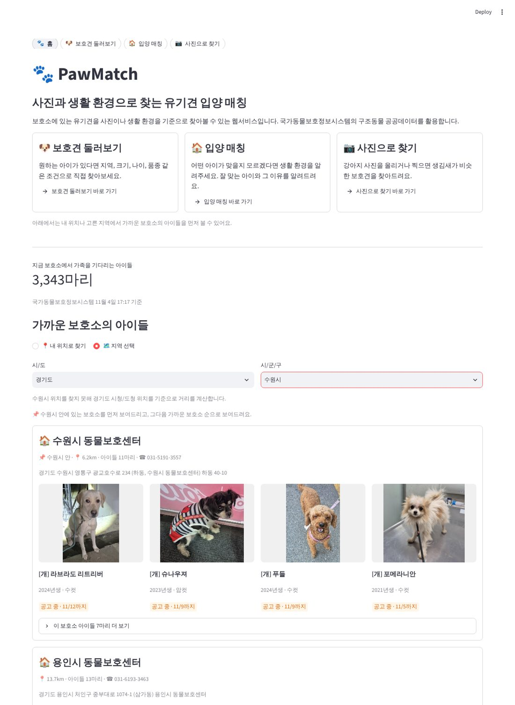
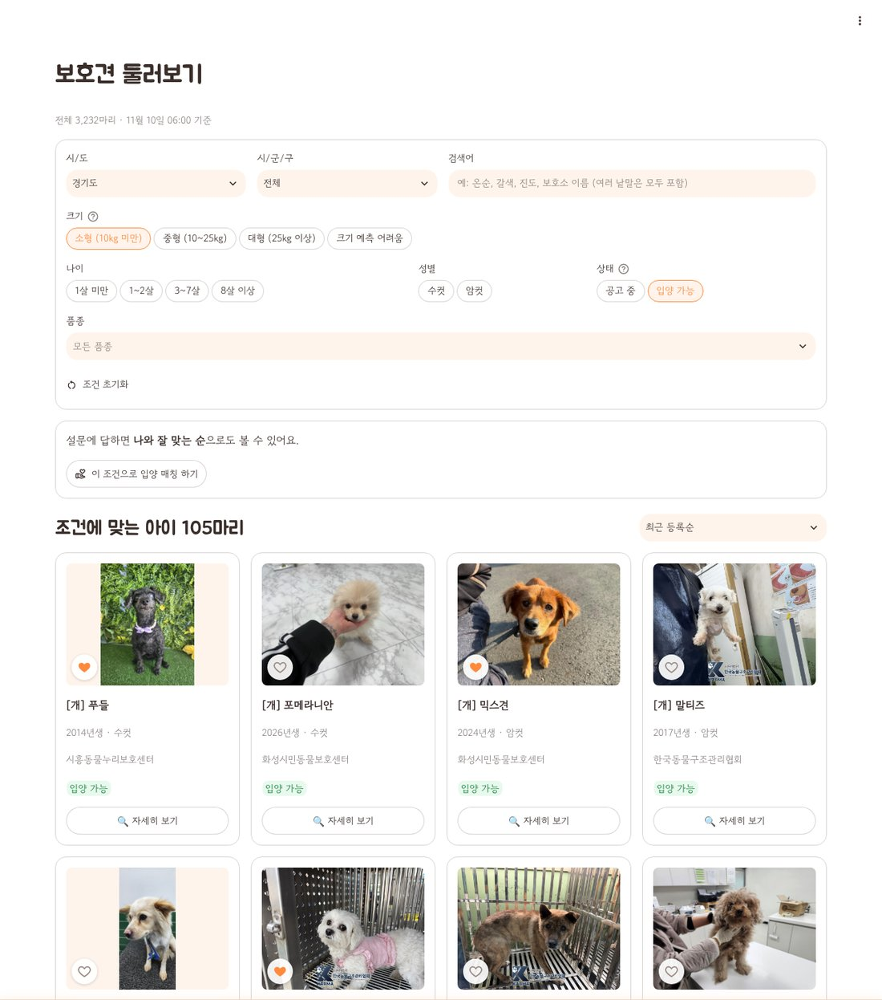
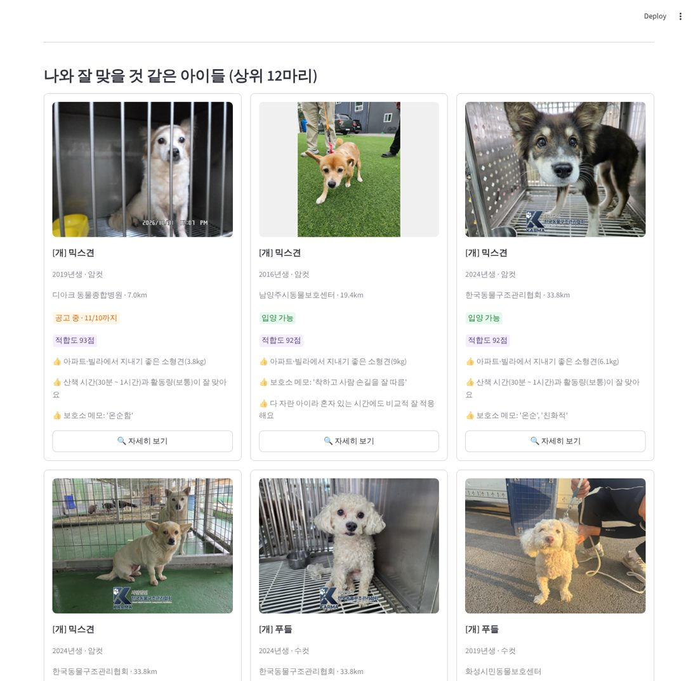
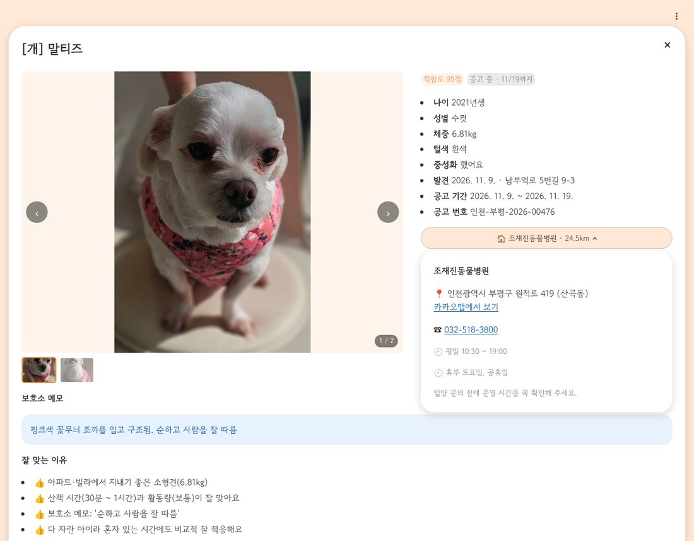
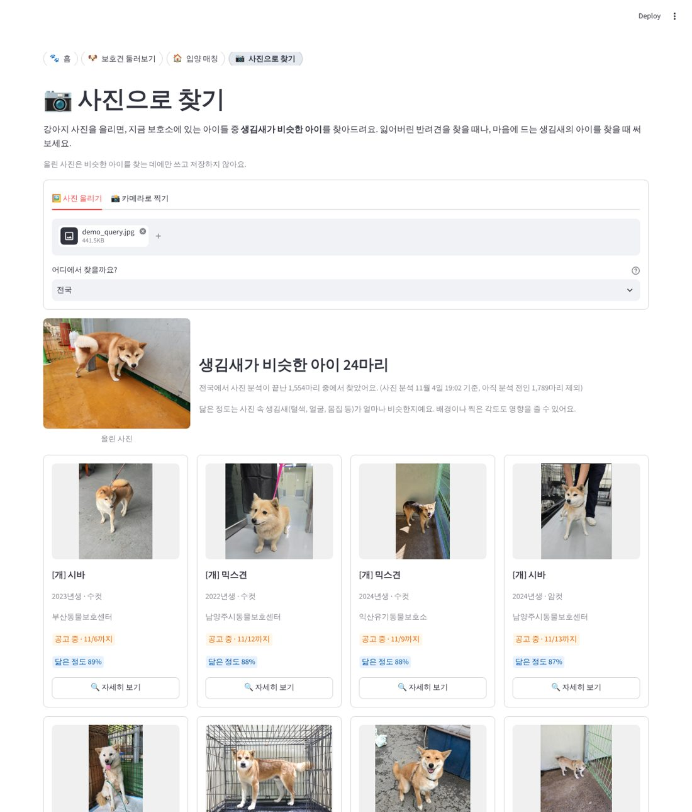
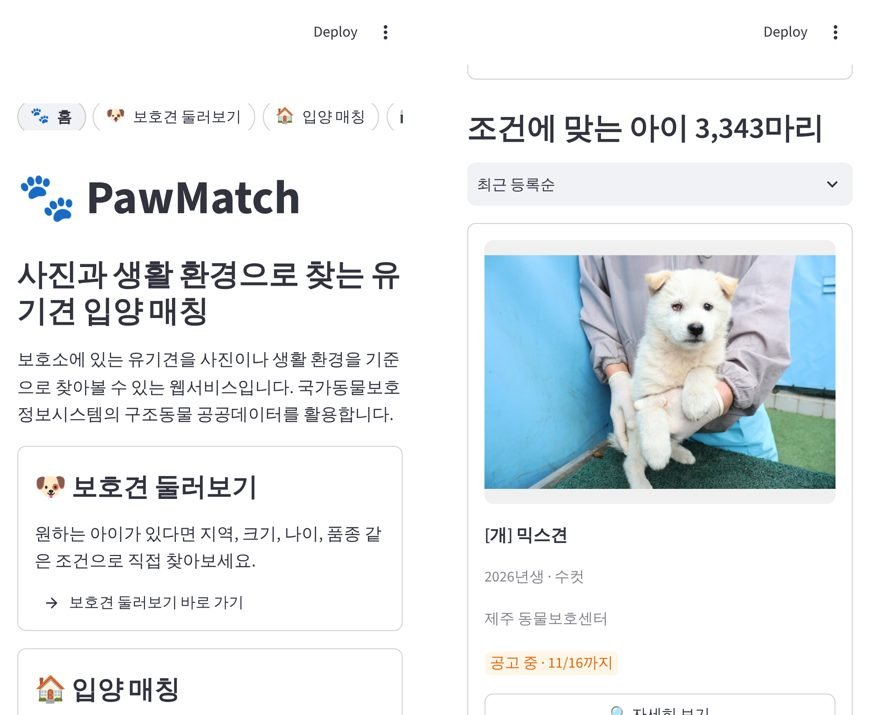

# 🐾 PawMatch

[](https://github.com/chodragon04/PawMatch/actions/workflows/test.yml)

**사진과 생활 환경으로 찾는 유기견 입양 매칭 웹서비스**

보호소에 있는 유기견을 사진이나 생활 환경을 기준으로 찾아볼 수 있는 웹서비스입니다.
국가동물보호정보시스템의 구조동물 공공데이터를 활용합니다. (오픈소스소프트웨어 텀프로젝트)

**🔗 데모: https://pawmatch-kr.streamlit.app**

- 🐾 **홈**: 내 위치나 고른 지역에서 가까운 보호소의 아이들부터 보기
- 🐶 **보호견 둘러보기**: 원하는 아이가 있다면 지역·크기·나이·품종 같은 조건으로 직접 찾기
- 🏠 **입양 매칭**: 어떤 아이가 맞을지 모르겠다면 생활 환경 설문으로 잘 맞는 아이와 그 이유 알아보기
- 📷 **사진으로 찾기**: 강아지 사진을 올리면 생김새가 비슷한 보호견 찾기

## 주요 기능

| 기능 | 설명 | 상태 |
| --- | --- | --- |
| 가까운 보호소 우선 보기 | 내 위치(또는 고른 시/도·시/군/구)에서 가까운 보호소 순으로, 보호소별로 묶어 표시 | 완료 |
| 보호견 둘러보기 | 원하는 조건(지역·크기·나이·성별·상태·품종·검색어)으로 직접 찾기, 최근 등록순·공고 마감 임박순·오래 기다린 순 정렬. 입양 매칭 설문을 했다면 '나와 잘 맞는 순'과 적합도 표시. 고른 조건을 입양 매칭으로 가져가기 | 완료 |
| 마감 임박 우선 보기 | 보호견 둘러보기의 '공고 마감 임박순' 정렬 | 완료 |
| 입양 매칭 | 생활 환경 설문(주거 형태, 산책 시간, 반려 경험, 가족 구성, 집 비우는 시간)으로 적합도 점수를 계산해 추천 이유·주의할 점과 함께 추천. 원하는 크기·나이·성별·품종은 선택 항목. '자세히 보기'로 사진 넘겨 보기·상세 정보·보호소 주소와 연락처 확인 | 완료 |
| 사진으로 찾기 | 강아지 사진을 올리거나 찍으면 사전학습 이미지 모델(CLIP)로 생김새가 비슷한 보호견 검색, 지역으로 좁히기 | 완료 |
| 화면 이동 | 모든 화면 위 바로가기 버튼 줄(모바일에서도 항상 보임), 홈 바로가기 카드. 다른 화면에 갔다 와도 입력한 조건 유지. 한 번 받은 내 위치·켠 카메라는 30분 동안 다시 묻지 않음 | 완료 |
| 데이터 자동 갱신 | GitHub Actions가 30분마다 데이터를 받아 두어 첫 화면이 빠르게 열림 | 완료 |

## 데모 / 스크린샷

배포 주소: **https://pawmatch-kr.streamlit.app** (Streamlit Community Cloud, main 브랜치가 자동 반영됨)

> Streamlit은 약 12시간 동안 아무도 쓰지 않은 앱을 재워 둡니다. GitHub Actions가 3시간마다 앱을 열어 깨워 두지만
> (`.github/workflows/keep-awake.yml`), 그래도 "Yes, get this app back up!" 버튼이 보이면 눌러서 깨워 주세요(1분 정도 걸림).
> 사진으로 찾기는 처음 사진을 올릴 때 분석 모델을 준비하느라 조금 더 걸립니다.

### 홈: 가까운 보호소의 아이들
고른 지역(예: 경기도 수원시) 안의 보호소를 먼저, 그다음 가까운 보호소 순으로 보호소별로 묶어 보여줍니다.



### 보호견 둘러보기: 조건으로 직접 찾기
지역·크기·나이·성별·상태·품종·검색어로 거르고, 최근 등록순·공고 마감 임박순·오래 기다린 순으로 정렬합니다.



### 입양 매칭: 생활 환경으로 잘 맞는 아이 추천
설문 답변으로 적합도 점수를 계산해, 잘 맞는 이유(👍)와 미리 알아두면 좋은 점(⚠️)을 함께 보여줍니다.



### 자세히 보기: 사진 넘겨 보기, 보호소 주소·연락처
모든 화면의 '자세히 보기'에서 보호소가 올린 사진을 모두 넘겨 보고, 보호소 이름을 누르면 주소·전화·운영 시간이 나옵니다.



### 사진으로 찾기: 생김새가 비슷한 아이
사진을 올리거나 찍으면 CLIP 이미지 모델로 생김새가 비슷한 보호견을 찾아 '닮은 정도'와 함께 보여줍니다.



### 휴대폰 화면
모든 화면 위에 바로가기 버튼 줄이 있어 휴대폰에서도 메뉴를 바로 찾을 수 있습니다.



## 기술 스택

- **언어**: Python 3.12 (3.10 이상에서 동작)
- **웹 프레임워크**: [Streamlit](https://streamlit.io/)
- **데이터**: 공공데이터포털 국가동물보호정보시스템 구조동물 조회 서비스
- **이미지 검색**: 사전학습 이미지 모델 CLIP ViT-B/32 (ONNX), [fastembed](https://github.com/qdrant/fastembed) + onnxruntime (PyTorch 없이 CPU로 실행)
- **데이터 갱신**: GitHub Actions (30분마다 실행, `data` 브랜치에 스냅샷 저장)
- **디자인**: 흰 배경 + 주황 포인트(`#FF8A3D`) 테마(`.streamlit/config.toml`), 휴대폰이 다크 모드여도 밝은 화면 유지. 글꼴 Jua(제목)·Gowun Dodum(본문)
- **배포**: [Streamlit Community Cloud](https://streamlit.io/cloud) (GitHub 푸시 시 자동 반영)

## 프로젝트 구조

```
PawMatch/
├── app.py               # Streamlit 진입점 (페이지 내비게이션)
├── CLAUDE.md            # AI 코딩 도구(Claude Code) 작업 규칙
├── .streamlit/config.toml # 화면 테마 (색·글꼴·모서리)
├── pytest.ini           # 테스트 설정 (프로젝트 루트를 모듈 경로에 추가)
├── views/               # 화면별 페이지 (app.py의 st.navigation으로 연결)
│   ├── home.py          # 홈
│   ├── browse.py        # 보호견 둘러보기
│   ├── match.py         # 입양 매칭
│   └── photo_search.py  # 사진으로 찾기
├── pawmatch/            # 핵심 로직
│   ├── config.py        # 환경 변수(API 키) 로딩
│   ├── api.py           # 공공데이터 API 클라이언트 (유기견, 보호소, 동시 요청·재시도)
│   ├── data.py          # 데이터 불러오기 (스냅샷 → API 순서)
│   ├── geo.py           # 거리 계산, 가까운 보호소 순 정렬, 시/도청 좌표
│   ├── regions.py       # 지역 선택 목록 (regions.json: 시/도 16곳, 시/군/구 229곳)
│   ├── kakao.py         # 카카오 로컬 API로 시/군/구 위치 찾기
│   ├── location.py      # 기준 위치 고르기 (내 위치 / 시·도 선택)
│   ├── state.py         # 여러 화면이 같이 쓰는 화면 상태 key (입력값 유지)
│   ├── traits.py        # 체중·나이·품종·특징 메모에서 크기·활동량·성격 추출
│   ├── matching.py      # 설문 기반 매칭 점수 계산
│   ├── browse.py        # 보호견 둘러보기 조건 검색·정렬
│   ├── display.py       # 나이·성별·공고 상태 표시 문구
│   ├── ui.py            # 유기견 카드·사진 캐러셀 (사진 대체 처리 포함), 데이터 로딩 화면
│   ├── detail.py        # 유기견 상세 정보 창 (사진, 정보, 보호소 주소·연락처)
│   └── image_search.py  # 사진으로 찾기: CLIP 임베딩 만들기·저장·유사도 검색
├── scripts/
│   ├── fetch_data.py    # 데이터 받아서 스냅샷 파일로 저장 (GitHub Actions에서 실행)
│   ├── build_embeddings.py # 보호견 사진 임베딩 만들기 (GitHub Actions에서 실행)
│   ├── build_regions.py # 구조동물 API의 시/도·시/군/구 목록으로 regions.json 생성
│   └── wake_app.py      # 배포된 앱을 브라우저로 열어 깨우기 (GitHub Actions에서 실행)
├── .github/workflows/
│   ├── update-data.yml  # 30분마다 데이터·사진 임베딩 갱신
│   ├── test.yml         # PR·main 반영 때마다 테스트 자동 실행
│   └── keep-awake.yml   # 3시간마다 배포된 앱을 열어 잠들지 않게 함
├── tests/               # 단위 테스트 (pytest)
├── data/                # 데이터 캐시 (Git에 올리지 않음)
├── docs/
│   ├── data-analysis.md # 공공데이터 필드 분석 (채워진 비율, 매칭에 쓸 정보)
│   └── images/          # README 스크린샷
├── requirements.txt
├── .env.example
└── LICENSE
```

## 실행 방법

1. 저장소 클론

   ```bash
   git clone https://github.com/chodragon04/PawMatch.git
   cd PawMatch
   ```

2. 가상환경 생성 및 패키지 설치

   ```bash
   python -m venv .venv
   source .venv/bin/activate   # Windows: .venv\Scripts\activate
   pip install -r requirements.txt
   ```

3. API 키 설정 (선택)

   API 키가 없어도 GitHub `data` 브랜치에 저장된 데이터(30분마다 갱신)로 실행됩니다.
   저장된 데이터가 오래됐을 때 앱이 뒤에서 API로 새로 받으려면 키가 필요합니다.

   [공공데이터포털](https://www.data.go.kr/)에서 "구조동물 조회 서비스"를 활용신청한 뒤,
   `.env.example`을 복사해 `.env`를 만들고 일반 인증키(Decoding)를 넣습니다.

   ```bash
   cp .env.example .env
   ```

   (`.streamlit/secrets.toml`을 써도 됩니다. `.streamlit/secrets.toml.example` 참고)

4. 실행

   ```bash
   streamlit run app.py
   ```

5. 데이터 직접 받기 (선택)

   API 키가 있으면 데이터를 받아 `data/snapshot/`에 저장해 둘 수 있습니다. 앱은 이 파일과 `data` 브랜치 스냅샷 중 새 것을 씁니다.

   ```bash
   python scripts/fetch_data.py
   ```

6. 테스트 (선택)

   ```bash
   pip install -r requirements-dev.txt
   pytest
   ```

   테스트는 실제 API·모델 없이 가짜 응답으로 돌아가서 API 키가 필요 없습니다.
   GitHub에서는 PR을 올리거나 main에 반영될 때마다 자동으로 돌아갑니다(`.github/workflows/test.yml`).

## 배포 (Streamlit Community Cloud)

1. [share.streamlit.io](https://share.streamlit.io/)에 GitHub 계정으로 로그인
2. **Create app** → 이 저장소, 브랜치, Main file `app.py` 선택
3. **Advanced settings**에서 Python **3.12** 선택(기본값 3.14로 만들었을 때 화면 없이 로딩만 도는 문제가 있었음), **Secrets** 칸에 아래 내용 입력

   ```toml
   DATA_GO_KR_API_KEY = "발급받은_일반_인증키(Decoding)"
   KAKAO_REST_API_KEY = "카카오_REST_API_키"   # 선택: 시/군/구 위치 찾기
   ```

4. **Deploy** 클릭. 이후 해당 브랜치에 푸시하면 자동으로 다시 배포됩니다.

## 데이터 자동 갱신 (GitHub Actions)

공공데이터 API는 한 번 요청에 2~9초가 걸리고 가끔 연결이 끊겨서, 데이터를 미리 받아 둡니다.

```
GitHub Actions (매시 7분·37분)        Streamlit 앱
  scripts/fetch_data.py                 pawmatch/data.py
  공공데이터 API → snapshot.json.gz  →  ① 로컬·data 브랜치 스냅샷 중 새 것을 바로 표시
  data 브랜치에 저장 (force push)       ② 40분보다 오래됐으면 뒤에서 새로 받아 바꿔 끼움
```

- `data` 브랜치는 매번 커밋 1개로 덮어써서 main의 커밋 기록에 영향을 주지 않습니다.
- GitHub의 예약 실행은 몇 시간씩 밀리거나 건너뛰는 경우가 있습니다(실제로 6시간 넘게 안 돈 적이 있음).
  그래서 앱은 **가진 데이터를 먼저 바로 보여주고**, 데이터가 40분보다 오래됐으면 **뒤에서** 새 스냅샷을 확인하고
  그래도 오래됐으면 API에서 직접 받아 바꿔 끼웁니다(5분에 한 번까지만 시도). 받은 데이터는 서버 안에서 모든 사용자가 같이 씁니다.
  첫 화면이 API 응답(5~15초)을 기다리는 경우는 저장된 스냅샷이 하나도 없을 때뿐입니다.
- 설정: 저장소 **Settings → Secrets and variables → Actions → New repository secret**에
  `DATA_GO_KR_API_KEY`(일반 인증키, Decoding)를 등록합니다.
- 수동 실행: **Actions → 보호견 데이터 갱신 → Run workflow**
- 화면에 쓰지 않는 개인 정보(보호소 대표자 이름, 동물등록번호)는 스냅샷에 저장하지 않습니다.
- 같은 워크플로에서 '사진으로 찾기'용 보호견 사진 임베딩(`embeddings.npz`)도 만듭니다(`scripts/build_embeddings.py`).
  이전에 계산한 사진은 다시 계산하지 않고 새로 들어온 아이의 사진만 계산하며, 한 번에 최대 30분까지만 계산하고 남은 사진은 다음 실행에서 이어 갑니다.

## 사진으로 찾기

- 보호견마다 사진을 최대 3장 골라, CLIP 이미지 인코더로 512차원 벡터(임베딩)를 미리 계산해 둡니다.
- 사용자가 올린 사진도 같은 모델로 벡터를 만들고, 코사인 유사도가 높은 순으로 보여줍니다.
  한 아이의 사진이 여러 장이면 가장 닮은 사진의 점수를 쓰고, 카드에도 그 사진을 먼저 보여줍니다.
- 직접 잰 결과 (보호견 389마리, 같은 아이의 다른 사진으로 검색): 같은 아이가 1위 82%, 5위 안 90%, 10위 안 93%.
  같은 아이 사진끼리 유사도 중앙값 0.95, 다른 아이끼리 0.75, 강아지가 아닌 그림은 0.55~0.60이라
  가장 닮은 아이가 0.7보다 낮으면 "많이 닮은 아이를 찾지 못했어요"라고 안내합니다.
  (같은 아이의 사진은 같은 장소에서 찍은 경우가 많아 배경이 점수를 높였을 수 있습니다)
- 사진 한 장 분석 약 70ms, 모델(약 340MB)은 서버가 처음 쓸 때 한 번 내려받아 모든 사용자가 같이 씁니다.
- 올린 사진은 비슷한 아이를 찾는 데에만 쓰고 저장하지 않습니다.

## 입양 매칭 점수

설문 응답과 보호소가 입력한 정보(체중, 나이, 품종, 특징 메모)로 항목별 점수(0~1)를 계산하고,
비중을 곱해 100점 만점으로 합칩니다. 어떤 정보가 얼마나 채워져 있는지는
[공공데이터 필드 분석](docs/data-analysis.md)에 정리했습니다.

| 항목 | 비중 | 근거 |
| --- | --- | --- |
| 크기 | 25 | 주거 형태 × 체중(10kg 미만 소형, 25kg 이상 대형). 1살 미만은 품종으로 다 자란 크기 추정 |
| 활동량 | 20 | 산책 시간 × 나이·활동적인 품종·특징 메모('활발', '얌전')로 추정한 활동량 |
| 성격 | 20 | 특징 메모의 '온순', '사람 좋아함'(가점), '겁', '사나움', '입질'(감점) × 반려 경험·가족 구성 |
| 돌봄 시간 | 15 | 집을 비우는 시간 × 나이 (60일 미만 강아지는 오래 혼자 두기 어려움) |
| 거리 | 15 | 기준 위치에서 보호소까지 거리 |
| 선호 | 5 | 원하는 크기·나이·성별, 치료가 필요한 아이도 괜찮은지 |

- 정보가 없으면(성격 메모 없음, 체중 오입력, 보호소 좌표 없음) 감점하지 않고 중간 점수(0.5)를 줍니다.
- 품종(여러 개 선택 가능)과 보호소까지 최대 거리는 점수가 아니라 조건입니다. 고르면 그에 맞는 아이만 추천합니다.
- '입질 없음', '사상충 음성'처럼 부정하는 표현은 반대로 해석합니다.
- 점수와 함께 "아파트·빌라에서 지내기 좋은 소형견(4.4kg)", "보호소 메모: '온순', '친화적'" 같은 추천 이유와
  주의할 점을 보여줍니다.

## 지역 선택 (시/도 → 시/군/구)

- 목록: 구조동물 조회 API의 시/도·시/군/구 조회 결과를 정리해 `pawmatch/regions.json`에 저장했습니다
  (`scripts/build_regions.py`). 일반구(수원시 권선구 등), 폐지된 지역(연기군)은 뺐고,
  2026년 기준 행정구역(전남광주통합특별시, 인천 제물포구·영종구·검단구·서해구 등)을 따릅니다.
- 위치: 시/군/구를 고르면 [카카오 로컬 API](https://developers.kakao.com/docs/latest/ko/local/dev-guide) 주소 검색으로
  그 지역의 좌표를 찾습니다(7일 캐시). 카카오 주소 데이터가 새 이름을 모르면 통합·명칭 변경 전 이름(광주광역시, 전라남도 등)으로 다시 찾습니다.
- 홈에서 지역을 고르면 **주소가 그 지역 안인 보호소를 먼저**(가까운 순), 그다음 나머지 보호소를 가까운 순으로 보여줍니다.
  보호소 주소의 옛 이름·줄임말(강원도, 전라남도, 충남 등)과 2026년 인천 개편 전 주소(중구·서구)도 지금 지역으로 바꿔 비교합니다.
- 공공데이터에 보호소로 등록되지 않은 시설(예: 인천시 반려동물 복지문화센터)은 표시되지 않습니다.
- 카카오 키(`KAKAO_REST_API_KEY`)가 없거나 찾지 못하면 시청/도청 위치를 기준으로 계산합니다.
  [Kakao Developers](https://developers.kakao.com/)에서 앱을 만들고 REST API 키를 발급받아 `.env` 또는 Streamlit Secrets에 넣으면 됩니다.

## 데이터 출처

- 농림축산식품부 농림축산검역본부, 국가동물보호정보시스템 구조동물 조회 서비스 (공공데이터포털)
- 농림축산식품부 농림축산검역본부, 국가동물보호정보시스템 동물보호센터 정보 조회 서비스 (공공데이터포털)

공공데이터포털에서 위 두 서비스를 모두 활용신청해야 합니다. (같은 인증키 사용)

## 참고자료

- [Streamlit Documentation](https://docs.streamlit.io/)
- [streamlit-js-eval](https://github.com/aghasemi/streamlit_js_eval) (MIT License): 브라우저 위치 정보(Geolocation) 가져오기에 사용
- [공공데이터포털](https://www.data.go.kr/)
- [카카오 로컬 API](https://developers.kakao.com/docs/latest/ko/local/dev-guide): 시/군/구 위치(좌표) 찾기에 사용
- [CLIP](https://github.com/openai/CLIP) (OpenAI, MIT License): 사진으로 찾기의 이미지 모델 (ViT-B/32).
  Radford et al., "Learning Transferable Visual Models From Natural Language Supervision", 2021
- [Qdrant/clip-ViT-B-32-vision](https://huggingface.co/Qdrant/clip-ViT-B-32-vision) (MIT License): CLIP 이미지 인코더를 ONNX로 변환한 모델 파일
- [fastembed](https://github.com/qdrant/fastembed) (Apache License 2.0), [ONNX Runtime](https://github.com/microsoft/onnxruntime) (MIT License): 모델 실행
- 글꼴 [Jua](https://fonts.google.com/specimen/Jua) (Woowahan Brothers), [Gowun Dodum](https://fonts.google.com/specimen/Gowun+Dodum) (Yanghee Ryu): Google Fonts, SIL Open Font License 1.1
- 본 프로젝트는 AI 코딩 도구(Anthropic Claude)의 도움을 받아 개발했습니다.

## 라이선스

이 프로젝트는 [MIT License](LICENSE)로 배포됩니다.
